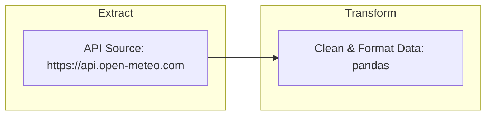

# Weather App
## Introduction
Basically, the program gets the data from **open-mateo** by **api**. Currently it only took the **weather of Hanoi** in the range of 7 days

## Data Engineering
I choose the ETL (Extract - Transform - Load) pipeline to make it simple and clear. Now I just done with the Transform step, I haven't move on to the Load secion yet cuz I still don't know how to load to Postgres

### Flow


## Requirements

***Requirements.txt***
```
pandas
matplotlib
requests
datetime
```

***How to install***
```
python -m venv .venv
.venv/Scripts/activate
python -m pip install -r requirements
```

