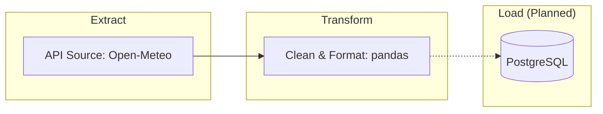

# Weather ETL Pipeline

## Introduction
This project is a simple data pipeline that fetches weather forecast data from the **Open-Meteo API**. Currently, the application retrieves and processes a **7-day weather forecast for Hanoi**.

## Data Architecture
The project follows a standard **ETL (Extract - Transform - Load)** architecture to keep the data flow clean and modular. 

* **Extract:** Fetch raw JSON data from the Open-Meteo API.
* **Transform:** Clean, format, and structure the data using `pandas`.
* **Load:** *(In Progress)* Load the transformed data into a **PostgreSQL** database.

### Pipeline Flow


## Setup & Installation

### 1. Prerequisites
Ensure you have Python 3.8+ installed. Create a `requirements.txt` file with the following dependencies *(Note: `datetime` is built-in and does not need to be installed)*:
```text
pandas
matplotlib
requests
```

### 2. Installation
Clone the repository and set up your virtual environment:

```bash
# Create virtual environment
python -m venv .venv

# Activate virtual environment (Windows)
.venv\Scripts\activate

# Install dependencies
python -m pip install -r requirements.txt
```

## Usage
Run the main pipeline script:
```bash
python show.py
```

## Roadmap
- [x] Extract weather data for Hanoi via API
- [x] Clean and transform data using Pandas
- [ ] Load processed data into PostgreSQL
- [x] Visualize temperature trends using Matplotlib
